# Components Map — PulsePoint (final build)

Stages: **TRIGGER → INPUT → CONTEXT → PROCESSING → OUTPUT** (following the FlixMatch map, AI Basics p.33).
**Database: Neon Postgres** (approved in place of Supabase). One database holds configuration, raw discussions, analyses, immutable weekly snapshots, votes, email and alert records. The app connects server-side only, with `postgres.js` over Neon's pooled connection string.

Rendered diagram: [components-map.svg](components-map.svg) · [components-map.png](components-map.png) · editable source: [architecture.mmd](architecture.mmd) (validated with `@mermaid-js/mermaid-cli`).

## Swimlane map (lane × stage)

| Lane | TRIGGER | INPUT | CONTEXT | PROCESSING | OUTPUT |
|---|---|---|---|---|---|
| **Sumit** (PM) | Opens the brief / email; picks **Week, Month or Range**; edits keywords; may click *Generate report* | Keyword edits (server actions) | | | Reads the brief, opens evidence, votes, **decides sprint priorities** (human decision) |
| **Team (Neha · Kabir)** | Opens the brief link | Picks their name once ("Who are you?") | | | 👍 / 👎 votes with names; the **named maintainer** receives failure alerts |
| **Vercel Cron** | Daily 06:30 IST (`0 1 * * *`) → `/api/cron/daily`; **Fri 06:00 IST** (`30 0 * * 5`) → `/api/cron/weekly` | `Authorization: Bearer $CRON_SECRET` | | | |
| **Pulse app** (Next.js on Vercel) | | Verifies `CRON_SECRET`; one run at a time; idempotent Friday report | Strips HTML, exact-phrase match, dedupes (source+id, fingerprint) | Validates Gemini JSON (zod), verifies quotes verbatim, computes counts / Δ / %Δ / trend / sufficiency **in code**, drops uncited AI claims; Month/Range views recompute metrics from stored data (no AI) | Friday brief, period views, votes, Topics, Sources, System health, Settings; brief email once per week; alert check after each scheduled run |
| **Platforms** (HN · Stack Overflow · GitHub) | | Official search APIs return discussions per keyword (GitHub needs `GITHUB_TOKEN`) | | | Original threads linked as evidence |
| **Gemini Flash** (Google AI Studio) | | | | ① classify discussions → JSON ② synthesise findings from computed metrics + evidence IDs | |
| **Neon** | | Topics, keywords, sources read | Discussions, keyword matches, pain-point catalog | Analyses, `topic_metrics`, `collection_runs` | Report snapshots; `finding_feedback` (votes), `brief_emails` (never twice), `alerts` (once per problem per day) |
| **Resend** | | | | | Friday brief email to `BRIEF_RECIPIENTS`; failure alert to `ALERT_EMAIL` |

Not connected: **Reddit — pending approval**; **Discord and X — not connected** (shown on the Sources page; no adapters built). **GitHub** is the version-control lane: `git push` to `main` → Vercel build and deploy.

## Key flows

1. **Daily (06:30 IST)** — Cron → secret check → collect from HN, Stack Overflow, GitHub (3-day overlap; 15-day backfill for new keywords) → normalise/dedupe → Gemini classification in batches → analyses stored. Unfinished work stays queued. On Fridays this run first re-sends the brief email if the weekly send failed.
2. **Friday brief (06:00 IST)** — Cron → final collection/analysis → metrics in code (this week vs last week) → Gemini synthesis over the computed metrics, uncited claims removed → immutable snapshot → **email** (claimed in `brief_emails` so a week is never emailed twice).
3. **Calendar** — Sumit picks **Month** (`?view=month&m=2026-10`) or **Range** (`?view=range&from=…&to=…`, max 92 days). Metrics are recomputed on the fly from stored analyses with the same code as the weekly report, against the previous period of equal length. Numbers only; the AI brief stays weekly.
4. **Votes** — Each teammate picks a name once (cookie) and votes 👍 / 👎 on findings, underserved explanations and recommendations; one vote per person per item. Weekly reports shows the usefulness rate across all voters.
5. **Alerts** — After every scheduled run: if the run failed, or a source failed in each of its last 3 runs, the named maintainer is emailed what failed, when, the error (secrets redacted) and a System health link — at most once per problem per day.

## Component table

| Component (course part) | Implementation | Responsibilities | Inputs | Outputs | Connects to |
|---|---|---|---|---|---|
| **Frontend** | `src/app/*`, `src/components/*` (Next.js App Router, React, Tailwind, `docs/DESIGN.md`) | Friday brief, Week/Month/Range picker, Weekly reports, Pain points, Topics & keywords; "More": Opportunities, Discussions, Sources, System health, Settings; team votes; Send test email | Server-rendered snapshots, metrics, runs, topics | Run requests, keyword edits, votes | Backend (route handlers, server actions); never Neon directly |
| **Backend** | `src/lib/pipeline/*`, `src/lib/{cron,email-send,alert-send,period-data}.ts`, `src/app/api/*` | Cron auth, orchestration with time budget, collection, dedupe, Gemini calls, validation, deterministic metrics, snapshots, brief email, alerts | Cron/manual triggers, config, API responses, model JSON | Rows in Neon, emails via Resend, JSON run summaries | All other components |
| **Database** | Neon Postgres; `db/migrations/0001–0007` via `npm run db:migrate` | Config, discussions, analyses, pain points, immutable reports, runs, votes, brief emails, alerts | Parameterised SQL from the backend | Query results | Backend only (`DATABASE_URL` server-side) |
| **API** (external) | HN Algolia, Stack Exchange, GitHub search, Gemini Flash `generateContent`, Resend | Live discussions; classification and synthesis; email delivery | HTTPS with keys from env | JSON, delivered email | Backend |
| **Version control** | GitHub `siddhantmaheshwari-hub/pulsepoint` | History and deploy trigger | Commits | Vercel deployments | Vercel |
| Hosting / scheduler | Vercel + `vercel.json` crons | Serverless functions (300 s max), scheduled GETs with `Bearer $CRON_SECRET` | Git pushes, schedule | Public URL, cron calls | GitHub, Backend |

## Mermaid source

```mermaid
flowchart LR
  %% PulsePoint — final architecture (editable Mermaid). Lanes match docs/COMPONENTS_MAP.md.
  subgraph SUMIT["Sumit — Product Manager"]
    U1(["Reads the Friday brief<br/>(email + web)"])
    U2(["Picks Week | Month | Range"])
    U3(["Edits topics & keywords"])
    U4(["Votes on AI findings"])
    U5(["Decides sprint priorities<br/>(human decision)"])
  end
  subgraph TEAM["Team — Neha · Kabir"]
    T1(["Vote useful / not useful<br/>(one vote per person)"])
    T2(["Named maintainer<br/>receives failure alerts"])
  end
  subgraph CRON["Vercel Cron"]
    C1[["Daily 06:30 IST (01:00 UTC)<br/>/api/cron/daily"]]
    C2[["Fri 06:00 IST (00:30 UTC)<br/>/api/cron/weekly"]]
  end
  subgraph APP["Pulse app — Next.js on Vercel"]
    direction TB
    A0{"CRON_SECRET check<br/>+ one run at a time"}
    A1["Collect per keyword × source<br/>(retry, backoff, circuit breaker)"]
    A2["Normalize: strip HTML,<br/>exact phrase, dedupe"]
    A3["Analyze in batches → Gemini<br/>(zod-validated, quotes verified)"]
    A4["Metrics in code: counts, Δ, %Δ,<br/>trend, sufficiency, underserved"]
    A5["Synthesis → Gemini<br/>(uncited claims dropped)"]
    A6["Store immutable weekly snapshot"]
    A7["Email the brief once per week"]
    A8["Alert check: scheduled run failed<br/>or source failed 3 runs in a row"]
    W1["Friday brief (Week view, AI reading)"]
    W2["Month / Range view: numbers only,<br/>computed from stored data, no AI call"]
    W3["Team votes 👍 / 👎 with names"]
    W4["Topics & keywords, Sources,<br/>System health, Settings"]
  end
  subgraph PLAT["Platforms (official APIs)"]
    P1[("Hacker News — Algolia")]
    P2[("Stack Overflow — Stack Exchange")]
    P3[("GitHub Issues — search")]
    P4[("Reddit — pending approval")]
    P5[("Discord · X — not connected")]
  end
  subgraph GEM["Gemini Flash — Google AI Studio"]
    G1["Classify discussions → JSON"]
    G2["Evidence-cited synthesis → JSON"]
  end
  subgraph NEON["Neon Postgres (server-side only)"]
    N1[("topics · keywords · sources")]
    N2[("discussions · matches · analyses · pain_points")]
    N3[("reports · topic_metrics · collection_runs")]
    N4[("finding_feedback (votes) · brief_emails · alerts")]
  end
  subgraph RES["Resend"]
    R1["Friday brief email"]
    R2["Failure alert email"]
  end
  subgraph GH["GitHub"]
    V1["main branch → Vercel deploy"]
  end

  C1 -- "GET + Bearer secret" --> A0
  C2 -- "GET + Bearer secret" --> A0
  A0 -- "read active config" --> N1
  A0 --> A1
  A1 -- "search" --> P1 & P2 & P3
  P1 & P2 & P3 -- "JSON" --> A2
  P4 -. "not collected" .-> A1
  P5 -. "not collected" .-> A1
  A2 -- "upsert" --> N2
  N2 -- "pending" --> A3
  A3 <-- "untrusted text fenced" --> G1
  A3 -- "analyses" --> N2
  N2 -- "two windows" --> A4
  A4 --> A5
  A5 <-- "metrics + evidence ids" --> G2
  A5 --> A6 -- "insert" --> N3
  A6 -- "weekly run only" --> A7
  A7 -- "claim week (never twice)" --> N4
  A7 --> R1 --> U1
  A0 -- "after every scheduled run" --> A8
  A8 -- "claim (problem, day)" --> N4
  A8 --> R2 --> T2
  N3 -- "latest snapshot" --> W1 --> U1
  U2 --> W2
  N2 -- "on-the-fly metrics" --> W2
  U4 --> W3
  T1 --> W3
  W3 -- "upsert vote" --> N4
  U3 --> W4 -- "server actions" --> N1
  U1 --> U5
  U5 -. "adjust keywords" .-> U3
  V1 -. "build & deploy" .-> APP
```

