# Components Map — PulsePoint

Stages: **TRIGGER → INPUT → CONTEXT → PROCESSING → OUTPUT** (following the FlixMatch map, AI Basics p.33).
**Database: Neon Postgres** (replaces Supabase; clearance confirmed). One database covers configuration, raw data, analyses and snapshots, so there is no second database to keep consistent. The app connects server-side with `postgres.js` over Neon's pooled connection string.

## Swimlane map (lane × stage)

| Lane | TRIGGER | INPUT | CONTEXT | PROCESSING | OUTPUT |
|---|---|---|---|---|---|
| **Sumit / PM** | Clicks *Collect & generate brief*; edits keywords | | | | Reads brief, opens evidence, decides Monday priorities |
| **Frontend** (Next.js) | | Run button → `POST /api/runs`; topic manager → server actions | | | Friday brief, pulse ladder, filters, evidence drawer, history, collection status |
| **Backend / Orchestration** | | Verifies `CRON_SECRET` / Basic auth; concurrency & idempotency guard; creates `collection_runs` row | Normalizes, strips HTML, exact-phrase match, dedupes (source+id, fingerprint) | Validates Gemini JSON (zod), verifies quotes verbatim, computes counts/Δ/%Δ/trend/sufficiency, drops uncited AI claims | Writes report snapshot; optional Slack notification |
| **External communities** | | HN Algolia & Stack Exchange (GitHub optional) return discussions for each keyword | | | Original threads linked from evidence |
| **Gemini Flash API** | | | | ① classify discussions → structured JSON ② synthesize findings from computed metrics | |
| **Neon Postgres** | | Active topics, keywords, sources read | Upsert discussions + keyword mentions; pain-point catalog | Store analyses, pain points, topic_metrics | Reports & history read by frontend |
| **Vercel** | Cron daily 01:00 UTC (collect+analyze); Fri 02:30 UTC = 08:00 IST (brief) | | | | Hosts app and functions |
| **GitHub** | `git push` → Vercel build & deploy | | | | |

## Editable Mermaid source

```mermaid
flowchart LR
  %% PulsePoint — end-to-end architecture (editable Mermaid)
  subgraph PM["Sumit / Product Manager"]
    PM1(["Opens Friday brief"])
    PM2(["Edits topics & keywords"])
    PM3(["Clicks Collect & generate brief"])
    PM4(["Reviews evidence, decides priorities"])
  end
  subgraph VER["Vercel — Scheduler & Hosting"]
    C1[["Cron daily 01:00 UTC<br/>/api/cron/daily"]]
    C2[["Cron Fri 02:30 UTC = 08:00 IST<br/>/api/cron/weekly"]]
    HOST["Hosts Next.js app & serverless functions"]
  end
  subgraph FE["Frontend — PulsePoint (Next.js / React / Tailwind)"]
    F1["Dashboard: Friday brief, lead signal, pain ranking, evidence drawer"]
    F2["Topics & keywords, Sources"]
    F3["Weekly reports, Pain points, Opportunities, Discussions, System health"]
  end
  subgraph BE["Backend — Route handlers & pipeline"]
    B0{"Auth: CRON_SECRET / Basic auth<br/>concurrency + idempotency guard"}
    B1["Collect: per keyword × source,<br/>paginate, retry, backoff"]
    B2["Normalize: strip HTML, phrase match,<br/>dedupe source+id & fingerprint"]
    B3["Analyze: batch 10 → Gemini,<br/>zod validate, verify quote verbatim"]
    B4["Deterministic metrics:<br/>unique discussions, Δ, %Δ, trend, sufficiency"]
    B5["Synthesize: Gemini over computed metrics,<br/>drop uncited claims"]
    B6["Store report snapshot + topic_metrics"]
  end
  subgraph EXT["External developer communities (official APIs)"]
    E1[("Hacker News — Algolia API")]
    E2[("Stack Overflow — Stack Exchange API")]
    E3[("GitHub Issues search — optional")]
  end
  subgraph GEM["Gemini Flash API"]
    G1["Structured extraction JSON"]
    G2["Evidence-cited synthesis JSON"]
  end
  subgraph SB["Neon Postgres (server-only connection via DATABASE_URL)"]
    S1[("topics, keywords, sources")]
    S2[("discussions, discussion_matches")]
    S3[("pain_points, discussion_analyses")]
    S4[("reports, topic_metrics, collection_runs")]
  end
  subgraph GH["GitHub — Version control"]
    R1["Repository main branch"]
  end

  R1 -- "git push → build & deploy" --> HOST
  C1 -- "HTTPS GET + Bearer secret" --> B0
  C2 -- "HTTPS GET + Bearer secret" --> B0
  PM3 --> F1 -- "POST /api/runs (Basic auth)" --> B0
  PM2 --> F2 -- "server action: insert/update" --> S1
  B0 -- "read active config" --> S1
  B0 --> B1
  B1 -- "search requests" --> E1 & E2 & E3
  E1 & E2 & E3 -- "JSON results" --> B2
  B2 -- "upsert discussions + mentions" --> S2
  S2 -- "pending discussions" --> B3
  B3 -- "prompt (untrusted text fenced)" --> G1
  G1 -- "JSON" --> B3
  B3 -- "insert analyses / pain points" --> S3
  S3 -- "analyses in 2 windows" --> B4
  B4 --> B5
  B5 -- "metrics + evidence ids" --> G2
  G2 -- "JSON" --> B5
  B5 --> B6 -- "insert" --> S4
  S4 -- "select latest report" --> F1
  S4 --> F3
  F1 --> PM1 --> PM4
  PM4 -. "adjust keywords" .-> PM2
  B6 -. "optional Slack webhook" .-> PM1
```

## Component table

| Component (course part) | Implementation | Responsibilities | Inputs | Outputs | Connects to |
|---|---|---|---|---|---|
| **Frontend** | `src/app/*`, `src/components/*` (Next.js App Router, React, Tailwind, design system in `docs/DESIGN.md`) | Nine sections: Dashboard (Friday brief), Weekly reports with week-vs-week comparison, Pain points, Opportunities, Discussions, Sources, Topics & keywords, System health, Settings; global search, week selector, comparison switch, freshness, Generate report; evidence drawer | Report snapshots, metrics, runs, topics (server-rendered) | User actions: run requests, keyword edits | Backend (route handlers, server actions); never Neon directly |
| **Backend** | `src/lib/pipeline/*`, `src/app/api/*`, `src/middleware.ts` | Auth, orchestration with time budget, collection, normalization, dedupe, Gemini calls, validation, deterministic metrics, report storage, notifications | Cron/manual triggers, config, API responses, model JSON | Rows in Neon, JSON run summaries | All other components |
| **Database** | Neon Postgres, `db/migrations/*.sql` applied by `npm run db:migrate` | Source of truth for config, discussions, mentions, analyses, pain-point catalog, immutable report snapshots, run logs; single server-side role; no public API | SQL from backend (batches wrapped in transactions) | Query results to backend | Backend only (`DATABASE_URL` server-side) |
| **API** (external) | Hacker News Algolia, Stack Exchange v2.3, GitHub search (optional), Gemini Flash `generateContent`, Slack webhook (optional) | Supply live discussions; structured extraction and synthesis; notification | HTTP requests with keys from env | JSON | Backend |
| **Version control** | GitHub repository | History, review, deploy trigger | Commits | Vercel deployments | Vercel |
| Hosting/Scheduler | Vercel + `vercel.json` crons | Run serverless functions; fire scheduled GETs with `Authorization: Bearer $CRON_SECRET` | Git pushes, schedule | HTTPS calls to cron routes; public URL | GitHub, Backend |

## End-to-end flow

1. **Daily 06:30 IST** Vercel Cron calls `/api/cron/daily`. The backend checks the secret, refuses to start if another run is active, reads active topics/keywords from Neon, and queries each enabled source per keyword (3-day overlap; 15-day backfill for new keywords). Results are phrase-checked, deduplicated and upserted.
2. Pending discussions go to **Gemini Flash** in batches of 10 with untrusted text fenced. Output is schema-validated; quotes not found verbatim in the source are discarded and confidence capped. Unfinished work stays queued for the next run.
3. **Friday 08:00 IST** `/api/cron/weekly` does a final collection/analysis pass, then deterministic code computes unique-discussion counts for this week vs. last week, Δ, %Δ (or "New"), trend, distinct sources, unresolved share and sufficiency.
4. Gemini receives the computed metrics plus evidence IDs and writes findings; any claim without a supplied evidence ID is removed. The report and per-pain-point metrics are stored as a versioned snapshot (idempotent: one scheduled report per week).
5. Sumit opens the brief (optionally pinged on Slack), filters, opens evidence, and decides. Manual runs and keyword edits go through the same backend path.
